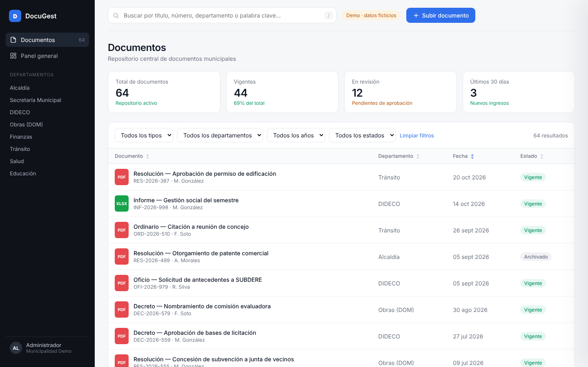
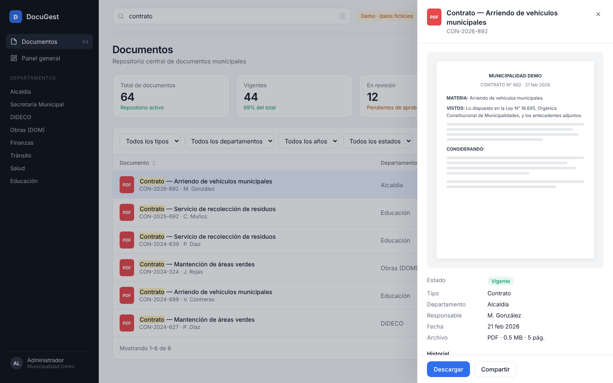

# DocuGest · Gestión documental para municipios

**Demo en vivo:** https://angelleiva-dev.github.io/docugest/

Sistema web para centralizar, buscar y revisar los documentos de una municipalidad (decretos, oficios, resoluciones, contratos, actas e informes). Esta es una versión demostrativa con datos ficticios, basada en la experiencia de desarrollar la plataforma documental de la Municipalidad de Lonquimay.

## Funcionalidades

- **Búsqueda instantánea** por título, número, departamento, responsable o palabra clave, con resaltado de coincidencias (atajo: tecla `/`).
- **Filtros combinables** por tipo de documento, departamento, año y estado.
- **Ordenamiento** por cualquier columna y paginación.
- **Panel de detalle** con vista previa, metadatos e historial de cada documento.
- **Carga de documentos** con arrastrar y soltar y validación del formulario.
- **Panel general** con indicadores y distribución por departamento.
- Navegación por departamento desde el menú lateral y diseño adaptable a celular.

## Tecnologías

JavaScript (sin frameworks) · HTML5 · CSS3

Todo está en un solo archivo, `index.html`. Los datos se generan en el navegador, y los documentos que se suben quedan guardados en `localStorage`.

## Ejecutarlo localmente

Basta con abrir `index.html` en el navegador.

---

Desarrollado por **Angel Leiva Romero** · [Portafolio](https://angelleiva-dev.github.io) · [LinkedIn](https://www.linkedin.com/in/angelltech)
